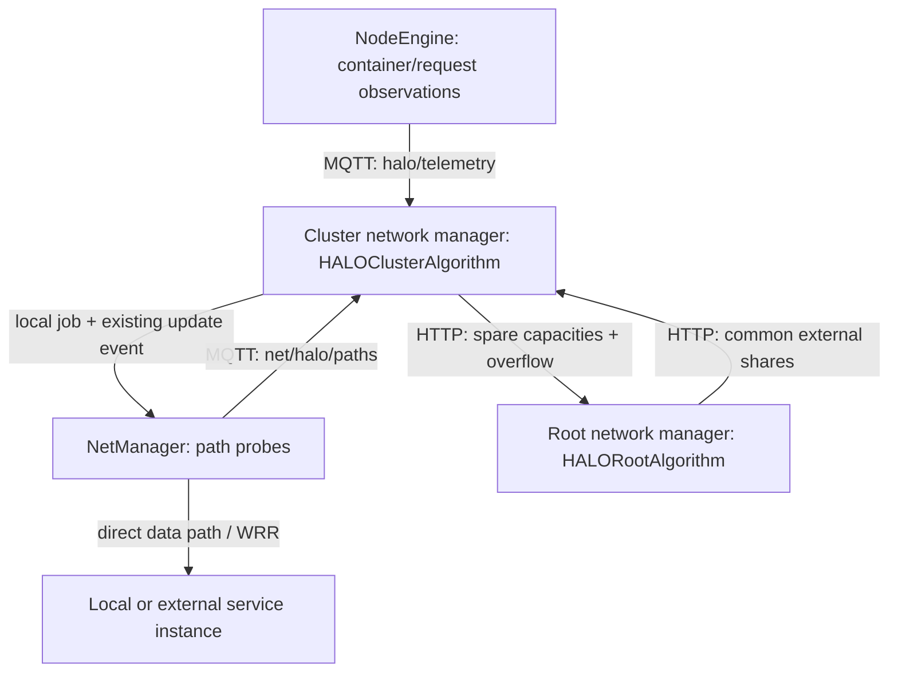

# High-level HALO design for the networking project

This plan integrates calculation and forwarding classes with this repository's existing processes. The [algorithm](algorithm.md) defines the mathematics; the [low-level plan](skeleton-implementation-low-level.md) defines exact files and contracts. Proposed integration points are not implemented yet.

## Components and communication

Clusters do not exchange raw resource reports with each other. The root does not deliver final edge tables directly to workers. Data goes from source edge to destination; reports go to the owning cluster manager, and only summaries go upward to the root.

## Ownership

| Responsibility | Execution point | Available information |
|---|---|---|
| Capacity estimation and local cost solve | Cluster network manager | Detailed local container measurements and local sources' path observations |
| Spare-capacity normalization | Root network manager | Instance capacity summaries and cluster overflow |
| Local/external integration | Source cluster network manager | Its local solution and a versioned root decision |
| Destination selection | Source-edge NetManager | Final row for that source; no cost solve |
| CPU and request observation collection | Companion project's NodeEngine | Measurements available at that edge, under the shared contract |

An edge may originate traffic without hosting the target service. It has a source row but no destination column. Hosting a manager also does not make an edge a processing destination for every service.

## Class locations and startup

Paths below are relative to this repository root. Every proposed file is new; none is claimed to exist already.

| Proposed file | Class or data | Existing startup point |
|---|---|---|
| `cluster-service-manager/service-manager/algorithms/halo_cluster.py` | `HALOClusterAlgorithm` and local types | [Cluster service_manager.py](../cluster-service-manager/service-manager/service_manager.py) |
| `root-service-manager/service-manager/algorithms/halo_root.py` | `HALORootAlgorithm` and summary types | [Root service_manager.py](../root-service-manager/service-manager/service_manager.py) |
| `node-net-manager/balancing/halo.go` | Go `HALO` selector and WRR state | [server.register](../node-net-manager/server/server.go), then the Datapath selection hook |
| `node-net-manager/balancing/types.go` | `HALOPolicy`, rows, destinations, and identities | MQTT decoding, service table, and selector |
| `node-net-manager/telemetry/ping.go` | Independent probe schedule, aggregation, and publishing | After NetManager registration |

Each new Python package also receives an empty `__init__.py`. Keep manager-specific input/output types with their class. Do not add another algorithm-registration framework or standalone HALO process. This checkout has no ready `Algorithm.Register` mechanism.

Create the cluster class after `mongo_init(app)` and before `mqtt_init(app)`. Create the root class after `mongo_init(app)` and before WSGI starts. Create one class instance per existing service-manager process, and reuse it for incoming messages.

The instance can be stored in `app.extensions["halo"]`. Receive callbacks submit valid data to a computation worker; they do not run a solver or blocking HTTP request. Allow one active computation per service and coalesce later reports into its next input snapshot.

Both existing [cluster](../cluster-service-manager/service-manager/Dockerfile) and [root](../root-service-manager/service-manager/Dockerfile) Dockerfiles run `python service_manager.py`; preserve that command. Legacy `start-up.sh` files refer to other filenames and are not the startup baseline for this plan.

## One decision cycle

1. NodeEngine publishes container and source observations at the end of a valid window. Idle edges and edges without a target-service instance must still be representable.
2. NetManager collects ping independently and sends its value, valid sample count, probe type, and observation age to its own cluster manager.
3. The cluster manager keeps each producer's latest valid data separately. It constructs capacity, demand, and path cost without converting unavailable data into measured zero.
4. For each service, it applies the local gate and solves source rows in a fixed order. New assignments share destination limits within that service; other services' assignments are not background-load terms.
5. It sends spare capacity after local reservation and overflow to the root. A fully local table can be prepared immediately without waiting for a root response.
6. The root recomputes shares when summaries change. It pushes decisions to every interested source cluster, including a cluster that only originates traffic.
7. The source cluster uses a compatible root decision only for overflow. Receiving a root decision updates integration; it does not alone trigger another local solve or a duplicate capacity report.
8. The complete final policy is stored locally. The existing update event triggers table refresh, and the edge installs its row without waiting for another calculation.

## Existing transport versus new messages

| Message | Current status | Proposed action |
|---|---|---|
| `nodes/<worker>/halo/telemetry` | New output from the core project | Subscribe through the cluster network manager's existing MQTT client |
| `nodes/<worker>/net/halo/paths` | New output from this project's probe collector | Use existing `PublishToBroker("halo/paths", payload)` |
| `POST /api/net/halo/capacity` | New route on root Flask application | Accept summaries and schedule root computation |
| `POST /api/net/halo/decision` | New route on cluster Flask application | Accept decisions and rebuild final rows |
| `jobs/<job>/updates_available` | Existing | Publish after final policy storage |
| `nodes/<worker>/net/tablequery/result` | Existing | Extend table results to carry the policy |

No extra listener, broker, or MQTT client is required; reuse the existing manager HTTP interfaces. The two HTTP routes and HALO message producers/consumers must still be implemented. This checkout has no ready `net/balancing` report. Adding a receive branch for a nonexistent report would be incomplete.

## Versions, freshness, and restarts

Each report identifies its producer, producer epoch, increasing sequence, observation window, and deployment revision. Each root decision records the summary versions it used. Final policies reference their local plan and consumed root decision.

Sequence numbers are comparable within an epoch. A new epoch must be associated with the active producer; lexical ordering of epoch strings does not establish chronology. Duplicate QoS1 delivery must not add the same window counts twice.

Report caches and WRR scores are short-lived and rebuilt from valid data after restart. Decision version handling must prevent rollback. A persisted old policy is not automatically fresh after restart.

A new observation epoch, deployment revision, or CPU allocation requires an appropriate new counter baseline. Baseline initialization is not a complete measurement window. Observation TTL, policy validity, and solver tolerance are explicit configuration, not invented validated thesis constants.

## Preserve the fast datapath

Place HALO selection in [resolveRoute](../node-net-manager/proxy/Datapath.go), after `ProxyCache.Revalidate`, replacing random selection for a new HALO-controlled flow or a route that failed revalidation. Do not move optimization into packet loops or redesign batching, TUN, address rewriting, or `FlowKey` for weight calculation.

Weight updates do not move live connections to another instance. Zero weight prevents new selection; it does not automatically terminate an existing flow. Actual destination removal differs from a weight change and needs separate tests.

An invalid HALO policy or absence of positive eligible destinations must not fall back to random selection. Preserve existing behavior only for services without HALO policy. The flow-versus-request distinction described in the [readme](readme.md) is part of experimental acceptance.

## Implementation sequence

First verify contracts and pure calculations against the thesis example. Then integrate manager receive/publication paths and connect WRR at the flow-selection boundary. Real telemetry and ingress tests are prerequisites for declaring a complete implementation; success with synthetic class inputs alone is insufficient.

The [low-level plan](skeleton-implementation-low-level.md) lists exact files and tests. NodeEngine, Compose, and worker installation belong to the [core project's plan](https://github.com/ECTLab/oakestra-load-balancing-project/blob/lb_develop/load-balancing-docs/skeleton-implementation-high-level.md).

## Exact LaTeX references

Section names below are English translations of the bundled headings. Labels are exact identifiers; source-line links identify the corresponding section in this snapshot. A parent section label is used where a subsection has no separate label. Wire formats, class paths, and startup adapters are repository-specific engineering choices.

| Subject in this document | Exact bundled section | Source labels |
|---|---|---|
| Proposed architecture and ownership | [Proposed algorithm](latex-reference/chapter3.tex#L6) (chapter3.tex:6) | `sec:proposed-algorithm`, `fig:algorithm-architecture` |
| Component/data boundaries | [Components, services, and data boundaries](latex-reference/system-model.tex#L19) (system-model.tex:19) | `sec:system-model` |
| Root summary contents | [Reporting spare capacity of each instance](latex-reference/method-root.tex#L6) (method-root.tex:6) | `tab:root-message`, `eq:root-available` |
| External decision publication | [Sending decisions to cluster managers](latex-reference/method-root.tex#L102) (method-root.tex:102) | `sec:root` |
| Table installation and event-driven forwarding | [WRR and event-driven updates](latex-reference/method-integration.tex#L96) (method-integration.tex:96) | `eq:wrr` |
